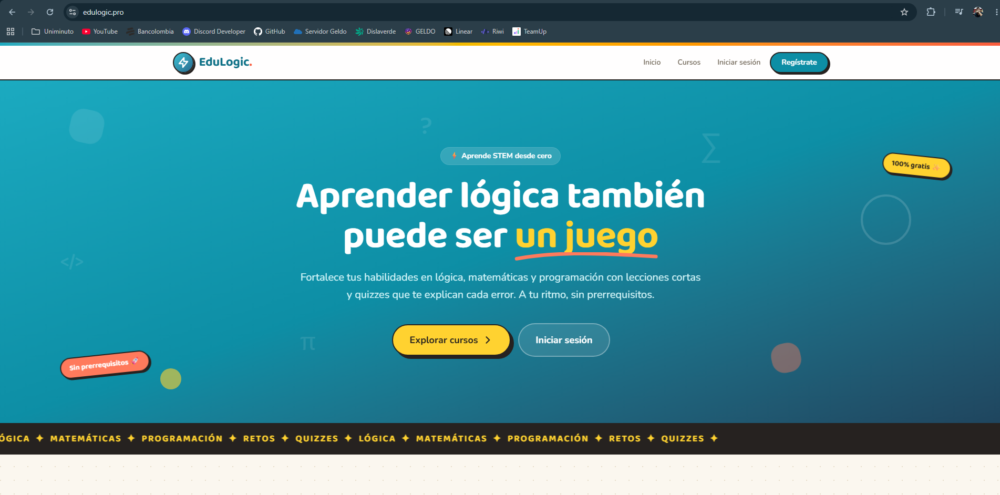
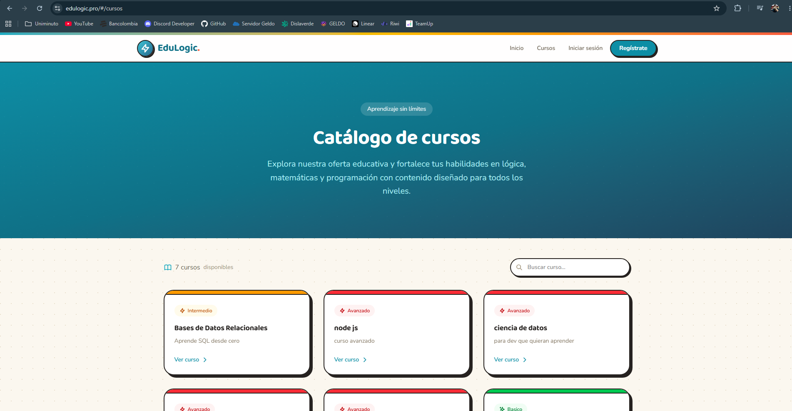
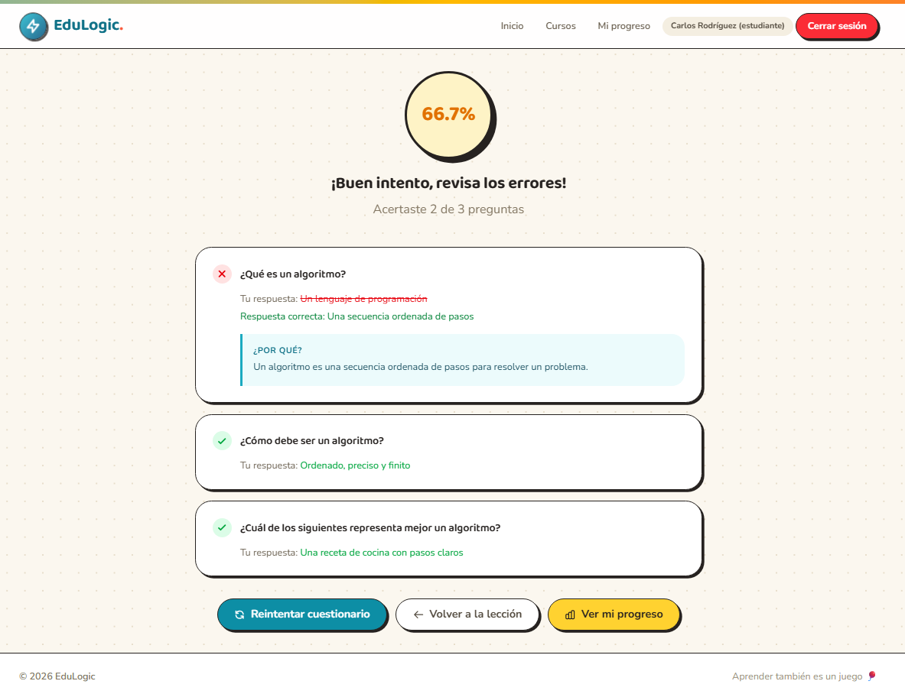
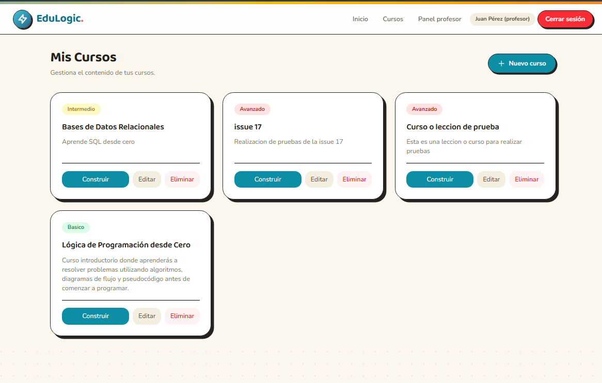
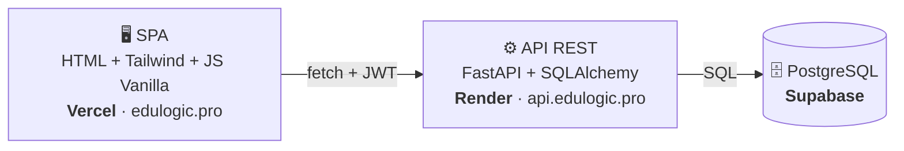

<div align="center">

# 🎓 EduLogic

**Plataforma de aprendizaje STEM con retroalimentación inmediata.**

*Aprender lógica, matemáticas y programación también puede ser un juego.*

[](https://edulogic.pro)
[](https://api.edulogic.pro/docs)
[](../../releases)

</div>

---

## 💡 El problema y la solución

La formación STEM es clave para el desarrollo económico —la OCDE proyecta que para 2050 la mayoría de los empleos estarán relacionados con estas áreas—, pero en Colombia la mayoría de los estudiantes no desarrolla competencias sólidas en lógica, matemáticas o programación. Y quien intenta aprender por su cuenta choca con materiales que asumen conocimientos previos y con evaluaciones que solo dicen *"incorrecto"* sin explicar por qué. El resultado: frustración y abandono.

**EduLogic** ataca ese problema con cursos de lecciones progresivas que parten desde cero y un **motor de evaluación que corrige al instante y explica cada error**: al fallar una pregunta, el estudiante recibe la explicación pedagógica de la respuesta correcta. Los reintentos son ilimitados —el error es parte del aprendizaje— y el progreso de cada estudiante queda registrado lección a lección.

## 🌐 Demo en vivo

| Recurso | URL |
|---|---|
| **Aplicación** | [https://edulogic.pro](https://edulogic.pro) |
| **API + documentación interactiva** | [https://api.edulogic.pro/docs](https://api.edulogic.pro/docs) |

**Usuarios de prueba** (las contraseñas se entregan junto con la evaluación, por fuera del repositorio):

| Rol | Correo |
|---|---|
| Estudiante | `carlos@gmail.com` |
| Profesor | `juan@edulogic.com` |
| Administrador | `admin@edulogic.com` |

> ⏱️ **Nota:** la API corre en el plan gratuito de Render y se suspende tras ~15 min de inactividad. Si la primera petición tarda ~50 segundos, es el arranque en frío — las siguientes responden normal.

## ✨ Funcionalidades

**Como estudiante 🧑‍🎓**
- Explora el catálogo de cursos libremente, sin prerrequisitos.
- Estudia lecciones ordenadas paso a paso y márcalas como completadas.
- Presenta cuestionarios con **corrección automática y explicación de cada error**, con reintentos ilimitados.
- Sigue tu avance en el panel *Mi progreso*: porcentaje por curso, lecciones completadas y tu mejor puntaje en cada quiz.

**Como profesor 🧑‍🏫**
- Crea y gestiona tus cursos con niveles (básico / intermedio / avanzado).
- Construye lecciones ordenadas y su cuestionario con preguntas, opciones y la explicación pedagógica de cada respuesta.

**Como administrador 🧑‍💼**
- Gestiona los usuarios de la plataforma: cambia roles, desactiva y reactiva cuentas (borrado lógico que preserva el historial).

**Transversal 🔒**
- Autenticación con JWT y contraseñas hasheadas con bcrypt; rutas y paneles protegidos por rol.
- SPA responsive (móvil, tablet y escritorio) con identidad visual propia.

## 📸 Capturas

| | |
|---|---|
|  |  |
|  |  |

## 🛠️ Tecnologías

| Tecnología | Por qué |
|---|---|
| **Python + FastAPI** | Validación automática con Pydantic y documentación interactiva (`/docs`) incluida |
| **SQLAlchemy** | ORM con control total de consultas y transacciones |
| **PostgreSQL (Supabase)** | Base relacional normalizada hasta 3FN, con integridad referencial |
| **HTML5 + Tailwind CSS v4 + JavaScript Vanilla** | SPA sin frameworks: dominio de los fundamentos del frontend |
| **Render + Vercel** | Despliegue continuo desde GitHub: cada release actualiza producción |
| **GitHub + GitHub Projects** | GitFlow con ramas protegidas y tablero Scrum con trazabilidad issue → rama → PR |

## 🏗️ Arquitectura

Tres capas desacopladas que se comunican por HTTP/JSON:



El detalle completo (estructura interna del backend, flujo de evaluación y configuración por entornos) está en [docs/arquitectura/arquitectura.md](docs/arquitectura/arquitectura.md), y el modelo de datos (ER + normalización 3FN) en [database/modelo/](database/modelo/README.md).

## 🚀 Instalación local

**Requisitos previos:** [Python 3.12+](https://www.python.org/downloads/), [Node.js 18+](https://nodejs.org/) y Git.

```bash
# 1. Clonar el repositorio
git clone https://github.com/DylanSrz/EduLogic.git
cd EduLogic

# 2. Instalar el orquestador y preparar todo (venv, dependencias, CSS)
npm install
npm run setup

# 3. Configurar los secretos (único paso manual)
#    Crea backend/.env usando backend/.env.example como plantilla.
#    Los valores (conexión a la base de datos y clave JWT) los entrega el equipo.

# 4. Levantar TODO con un solo comando (API + CSS + frontend)
npm run dev
```

Aplicación en [http://localhost:5500](http://localhost:5500) · API en [http://127.0.0.1:8000/docs](http://127.0.0.1:8000/docs). Funciona en Windows, macOS y Linux.

<details>
<summary>Prefieres levantar cada parte por separado — clic aquí</summary>

```bash
# Backend (desde backend/)
python -m venv .venv
.venv\Scripts\activate            # Windows  ·  source .venv/bin/activate en macOS/Linux
pip install -r requirements.txt
uvicorn app.main:app --reload

# Frontend (desde frontend/, en otra terminal)
npm install
npm run dev                        # compila Tailwind en modo watch
python -m http.server 5500         # y en otra terminal, servir la SPA
```

Los datos semilla están en [database/semillas/](database/semillas/).

</details>

## 📁 Estructura del proyecto

```
EduLogic/
├── backend/            # API REST: FastAPI + SQLAlchemy
│   └── app/
│       ├── routers/    # Endpoints por recurso (auth, cursos, lecciones, ...)
│       ├── services/   # Lógica de negocio (motor de evaluación, seguridad, progreso)
│       ├── models/     # Tablas (SQLAlchemy)
│       └── schemas/    # Validación de entrada/salida (Pydantic)
├── frontend/           # SPA: HTML + Tailwind + JS Vanilla con router por hash
│   ├── js/vistas/      # Una vista por pantalla
│   └── css/            # Sistema de diseño (entrada.css → estilos.css compilado)
├── database/           # Modelo ER, scripts SQL y datos semilla
├── docs/               # Documento técnico, actas, mockups, pruebas y evidencias
└── scripts/            # Orquestación multiplataforma (setup y arranque unificado)
```

## 👥 Equipo

| Integrante | Rol | GitHub |
|---|---|---|
| Dylan Alberto Suarez Laverde | Scrum Master / Líder + Backend | [@DylanSrz](https://github.com/DylanSrz) |
| Harold Ernesto Aristizabal Martinez | Product Owner + Backend | [@harold-855](https://github.com/harold-855) |
| Axel David Ruiz Poll | Frontend | [@Arp34](https://github.com/Arp34) |
| Samuel Roncancio Bertel | Frontend | [@samueroncancio-rgb](https://github.com/samueroncancio-rgb) |
| Mateo Hernandez Mendoza | Base de Datos | [@mateoriwi](https://github.com/mateoriwi) |
| Yuranys Castro Ruiz | Base de Datos *(participó hasta el 17/07/2026)* | — |

## 🔗 Enlaces del proyecto

- 📋 [Tablero Scrum (GitHub Projects)](https://github.com/users/DylanSrz/projects/6)
- 📘 [Documento técnico](docs/documento-tecnico.md)
- 🎨 [Mockups](docs/mockups/)
- 🧪 [Casos de prueba](docs/pruebas/casos-de-prueba.md)
- 🏷️ [Releases](../../releases)

---

<div align="center">

Barranquilla, Colombia — Proyecto Integrador · Riwi · 2026

</div>
