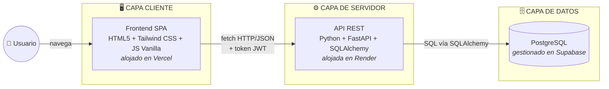
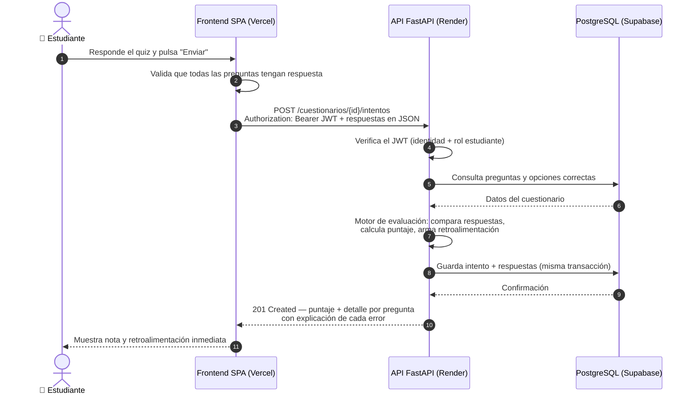

# 🏗️ Arquitectura de la Solución — EduLogic

> Este documento describe las piezas que componen EduLogic, cómo se comunican y por qué se eligió cada tecnología. Los diagramas están en formato Mermaid: GitHub los renderiza automáticamente y cualquier integrante puede editarlos como texto.

## 1. Visión general

EduLogic sigue una arquitectura de **tres capas desacopladas**: un frontend SPA que corre en el navegador, una API REST que concentra toda la lógica de negocio, y una base de datos relacional. Cada capa se despliega de forma independiente y solo se comunica con la siguiente a través de una interfaz bien definida (HTTP/JSON entre cliente y API; SQL entre API y base de datos).



**Responsabilidad de cada capa:**

| Capa | Qué hace | Qué NO hace |
|---|---|---|
| **Cliente (SPA)** | Interfaz, navegación sin recargas, validaciones de formulario (experiencia de usuario), consumo de la API | No contiene lógica de negocio ni secretos; no decide permisos (solo los refleja) |
| **Servidor (API)** | Autenticación JWT, autorización por roles, validación de datos, reglas de negocio (motor de evaluación), acceso a datos | No genera HTML; no conoce nada de la interfaz |
| **Datos (PostgreSQL)** | Persistencia con integridad referencial, modelo normalizado a 3FN | No contiene lógica de negocio (sin triggers ni procedimientos: todo vive en la API, donde es visible y sustentable) |

## 2. Estructura interna del backend

La API se organiza por responsabilidades, de modo que una petición atraviesa capas con roles claros:

```
routers/    → reciben la petición HTTP, validan permisos y delegan (no contienen lógica)
schemas/    → definen la forma de los datos que entran y salen (Pydantic)
services/   → lógica de negocio pura (ej: motor de evaluación) — no saben de HTTP
models/     → las tablas como clases de SQLAlchemy
database.py → conexión, sesiones y transacciones
```

Separar `services/` de `routers/` permite probar la lógica de negocio sin montar un servidor y mantiene los endpoints legibles.

## 3. Flujo de una petición real: el estudiante envía un cuestionario

El flujo más importante del sistema (HU-06 y HU-07) recorre las tres capas:



Dos decisiones de seguridad visibles en este flujo:

1. **Las respuestas correctas nunca viajan al navegador**: el frontend recibe las preguntas sin el campo `es_correcta`; la calificación ocurre exclusivamente en el servidor. Aunque un estudiante inspeccione el código o la red, no puede ver las respuestas.
2. **El `creador/usuario` sale del token, no del cuerpo de la petición**: la API nunca confía en que el cliente diga quién es; lo verifica con la firma del JWT.

## 4. Justificación tecnológica

### Backend — Python + FastAPI

- Framework moderno de APIs: **valida los datos automáticamente** con Pydantic (tipos, formatos, campos obligatorios) y responde errores 422 consistentes sin código extra.
- Genera **documentación interactiva automática** (`/docs`), que el equipo usa para probar cada endpoint durante el desarrollo y sirve como evidencia funcional.
- Python es el lenguaje de formación del equipo en la Ruta Básica: menos curva de aprendizaje, más velocidad de desarrollo.
- *Alternativa considerada:* Flask — más minimalista, pero exige librerías y configuración adicionales para lograr la validación y documentación que FastAPI trae de fábrica.

### ORM — SQLAlchemy

- Permite modelar las tablas como clases de Python y navegar relaciones (`curso.lecciones`) manteniendo control total sobre las consultas.
- Maneja sesiones y **transacciones**: el intento y sus respuestas se guardan juntos o no se guarda nada.
- Conexión directa a PostgreSQL mediante cadena estándar: la base de datos es intercambiable sin tocar la lógica.

### Base de datos — PostgreSQL (gestionado en Supabase)

- **Relacional**, como exige el proyecto: llaves foráneas e integridad referencial garantizan que no existan intentos sin usuario ni opciones sin pregunta.
- Soporta el **modelo normalizado a 3FN** (ver `database/modelo/`).
- **Supabase** aloja la base de datos: plan gratuito estable, la misma instancia compartida por todo el equipo en desarrollo y producción, y panel visual (Table Editor / SQL Editor) que facilita verificar datos y mostrar el modelo en la sustentación.
- *Alternativas consideradas:* MySQL (equivalente, pero PostgreSQL ofrece tipos más ricos y es el estándar de los servicios gratuitos modernos); MongoDB (descartada: el dominio es naturalmente relacional — cursos→lecciones→cuestionarios→preguntas→opciones — y el proyecto pide normalización); Postgres local (descartado: 6 instalaciones desincronizadas y de todas formas haría falta una instancia en la nube para producción); Render PostgreSQL (descartado: el plan gratuito expira a los 30 días).

### Frontend — HTML5 + Tailwind CSS + JavaScript Vanilla (SPA)

- El proyecto **prohíbe frameworks** de frontend: construir la SPA con JavaScript puro (router propio con `hashchange`, renderizado dinámico del DOM) demuestra dominio de los fundamentos que los frameworks abstraen.
- **Tailwind CSS** (permitido explícitamente) acelera el diseño responsive con clases utilitarias y mantiene la consistencia visual sin hojas de estilo gigantes.
- La navegación SPA (sin recargas) cumple el requisito técnico y da experiencia de aplicación, no de sitio de páginas.

### Despliegue — Render (API) + Vercel (frontend)

- **Render** ejecuta servicios Python con plan gratuito y despliegue automático desde GitHub (rama `main`, carpeta `backend/`).
- **Vercel** es ideal para sitios estáticos como nuestra SPA (carpeta `frontend/`), también gratuito y conectado a GitHub.
- Limitación conocida y documentada: el plan gratuito de Render duerme el servicio tras ~15 min sin tráfico (primera petición tarda ~30-60 s en despertarlo). Mitigación para demos: abrir la URL minutos antes.

### ¿Por qué frontend y backend separados?

1. **Despliegue y trabajo independientes**: el equipo de frontend y el de backend avanzan en paralelo sin bloquearse, integrándose solo por el contrato de la API.
2. **La API es reutilizable**: mañana una app móvil consumiría exactamente los mismos endpoints sin tocar el servidor.
3. **Refleja la arquitectura estándar de la industria** (cliente/servidor con API REST), que es parte de lo que el equipo debe aprender y sustentar.

## 5. Configuración entre entornos

Toda la configuración sensible o variable vive en **variables de entorno**, nunca en el código:

| Variable | Uso |
|---|---|
| `DATABASE_URL` | Cadena de conexión a PostgreSQL (Supabase) |
| `SECRET_KEY` | Firma de los JWT (distinta en local y producción) |
| `ACCESS_TOKEN_EXPIRE_MINUTES` | Vigencia de la sesión |
| `CORS_ORIGINS` | Orígenes autorizados a consumir la API (en producción, solo la URL de Vercel) |

Así el mismo código corre en local y en producción sin modificaciones, y el repositorio nunca contiene credenciales (`.env` está en `.gitignore`; `backend/.env.example` documenta las variables).
