# 🧪 Casos de Prueba — EduLogic MVP

> **¿Para qué sirve este documento?**
> Cada fila es un escenario concreto que CUALQUIER integrante del equipo puede ejecutar
> siguiendo los pasos, sin necesidad de conocer el código. Se escriben ANTES de la fase
> de pruebas para probar con método, no "a lo que salga".
>
> **Cómo ejecutar un caso:**
> 1. Leer la columna **Precondiciones** (qué debe existir antes de empezar).
> 2. Seguir los **Pasos** exactamente como están escritos.
> 3. Comparar lo que ocurrió con el **Resultado esperado**.
> 4. Actualizar **Estado** → `✅ Aprobado` / `❌ Falló` o `❌ Anulado` y adjuntar captura en **Evidencia**.
>
> **Convención de IDs:** `CP-XX` donde XX es número secuencial de dos dígitos.
> **Trazabilidad:** cada caso referencia la historia de usuario que cubre (HU-XX).

---

## 📋 Resumen de cobertura

| Módulo | Casos | HU cubiertas |
|---|---|---|
| Registro / Login | CP-01 → CP-07 | HU-02, HU-03 |
| Catálogo y cursos | CP-08 → CP-11 | HU-01, HU-04 |
| Lecciones y progreso | CP-12 → CP-16 | HU-05, HU-08, HU-09 |
| Quiz (módulo crítico) | CP-17 → CP-22 | HU-06, HU-07, HU-10 |
| Permisos y rutas protegidas | CP-23 → CP-27 | HU-03, HU-11, HU-14, HU-15, HU-18 |
| Panel del profesor | CP-28 → CP-29 | HU-11, HU-12, HU-13 |
| Panel del administrador | CP-30 → CP-33 | HU-15, HU-16, HU-17 |
| Responsive | CP-34 | HU-01 |

Nota: El caso CP-21 (HU-10) fue anulado por decisión del equipo.

**Total: 34 casos** (supera el mínimo esperado de 30).

---

## 🔐 Módulo 1 — Registro / Login

> **Precondición global de este módulo:** la aplicación está desplegada y accesible.
> El usuario NO tiene sesión iniciada al comenzar cada caso, salvo que se indique lo contrario.

---

### CP-01 — Registro exitoso (caso feliz) · HU-02

| Campo | Contenido |
|---|---|
| **Módulo** | Registro / Login |
| **Descripción** | Un visitante se registra con datos válidos y obtiene acceso a la plataforma. |
| **Precondiciones** | El correo `nuevo@test.com` NO existe en la base de datos. |
| **Pasos** | 1. Abrir la página principal → hacer clic en **Registrarse**.  2. Ingresar nombre: `Ana Torres`, correo: `nuevo@test.com`, contraseña: `Segura123`, confirmar contraseña: `Segura123`.  3. Hacer clic en **Crear cuenta**. |
| **Resultado esperado** | Se muestra un mensaje de bienvenida y se redirige al inicio de sesión (o al dashboard). El correo `nuevo@test.com` aparece en la base de datos con la contraseña almacenada como hash bcrypt (nunca texto plano). |
| **Estado** | ✅ Aprobado |
| **Evidencia** | 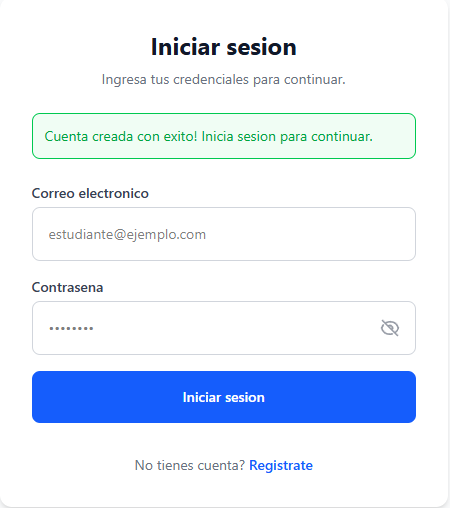 |

---

### CP-02 — Registro con email duplicado · HU-02

| Campo | Contenido |
|---|---|
| **Módulo** | Registro / Login |
| **Descripción** | El sistema rechaza el registro si el correo ya está en uso. |
| **Precondiciones** | Existe el usuario `profesor1` en la base de datos. |
| **Pasos** | 1. Ir al formulario de registro.  2. Ingresar nombre: `Otro Usuario`, correo del `profesor1` (ya registrado), contraseña: `contraseña_profe1`.  3. Hacer clic en **Crear cuenta**. |
| **Resultado esperado** | Se muestra el mensaje de error: *"El email ya está registrado."* No se crea ningún usuario nuevo. El servidor responde HTTP 409. |
| **Estado** | ✅ Aprobado |
| **Evidencia** |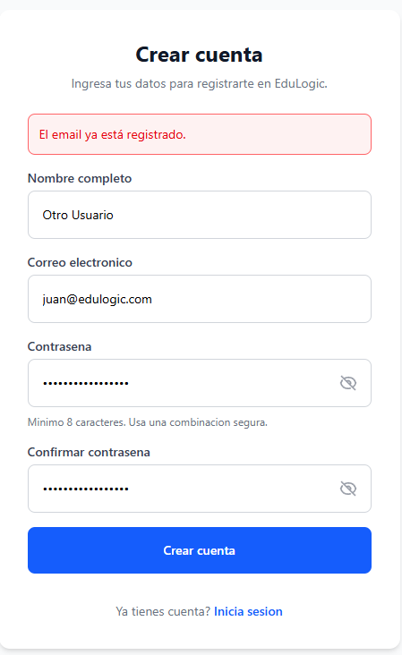|

---

### CP-03 — Registro con email con formato inválido · HU-02

| Campo | Contenido |
|---|---|
| **Módulo** | Registro / Login |
| **Descripción** | El sistema rechaza correos con formato incorrecto. |
| **Precondiciones** | Ninguna cuenta creada. |
| **Pasos** | 1. Ir al formulario de registro.  2. Ingresar correo: `esto-no-es-un-correo`.  3. Intentar enviar el formulario. |
| **Resultado esperado** | El formulario no se envía. Se muestra un mensaje de validación indicando que el correo no es válido (puede ser validación del cliente o error 422 del servidor). |
| **Estado** | ✅ Aprobado |
| **Evidencia** | 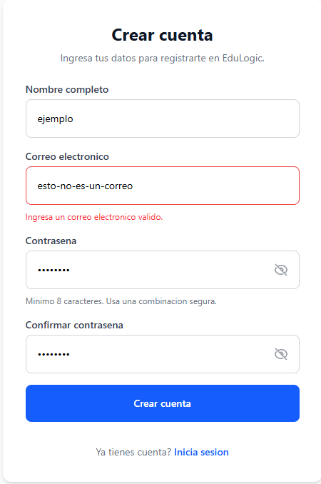 |

---

### CP-04 — Registro con contraseña corta · HU-02

| Campo | Contenido |
|---|---|
| **Módulo** | Registro / Login |
| **Descripción** | El sistema rechaza contraseñas de menos de 8 caracteres. |
| **Precondiciones** | Ninguna. |
| **Pasos** | 1. Ir al formulario de registro.  2. Ingresar datos válidos excepto contraseña: `abc12` (5 caracteres).  3. Intentar enviar. |
| **Resultado esperado** | El sistema bloquea el envío y muestra que la contraseña debe tener al menos 8 caracteres. El servidor responde HTTP 422 si la validación ocurre allí. |
| **Estado** |✅ Aprobado  |
| **Evidencia** | 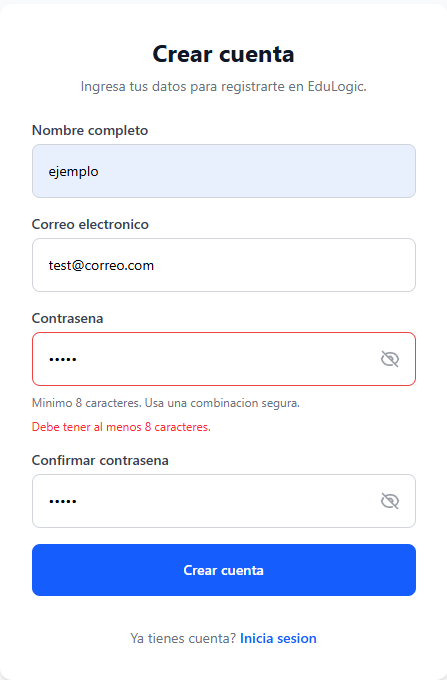 |

---

### CP-05 — Login exitoso (caso feliz) · HU-03

| Campo | Contenido |
|---|---|
| **Módulo** | Registro / Login |
| **Descripción** | Un usuario con cuenta activa inicia sesión correctamente. |
| **Precondiciones** | Existe el usuario `estudiante1` (usuario: `carlos@gmail.com`, contraseña: `contraseña_estudiante1`) con cuenta activa. |
| **Pasos** | 1. Ir al formulario de inicio de sesión.  2. Ingresar usuario: `carlos@gmail.com` y contraseña: `contraseña_estudiante1`.  3. Hacer clic en **Iniciar sesión**. |
| **Resultado esperado** | Se redirige al dashboard. La interfaz muestra el nombre del usuario. Se genera y almacena un token JWT válido. El servidor responde HTTP 200 con `access_token`. |
| **Estado** | ✅ Aprobado |
| **Evidencia** | 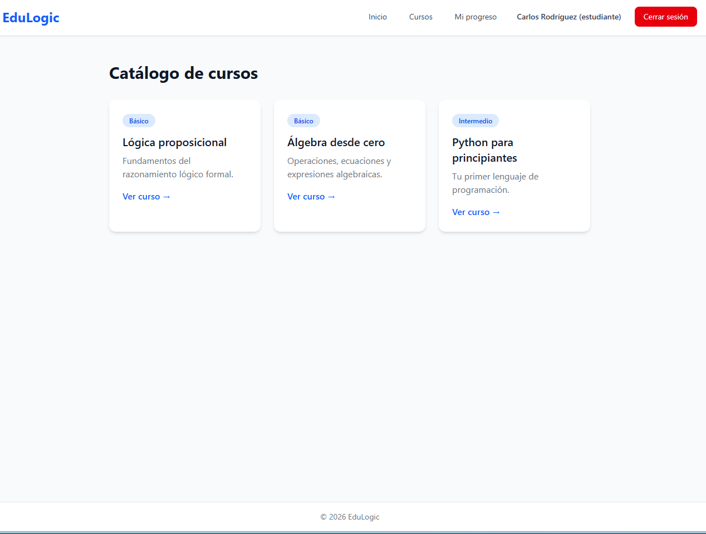 |

---

### CP-06 — Login con credenciales incorrectas · HU-03

| Campo | Contenido |
|---|---|
| **Módulo** | Registro / Login |
| **Descripción** | El sistema rechaza el acceso con contraseña errónea sin revelar qué dato falló. |
| **Precondiciones** | Existe el usuario `carlos@gmail.com` en la base de datos. |
| **Pasos** | 1. Ir al formulario de login.  2. Ingresar usuario: `carlos@gmail.com`, contraseña: `ClaveIncorrecta99`.  3. Hacer clic en **Iniciar sesión**. |
| **Resultado esperado** | Se muestra el mensaje genérico: *"Credenciales incorrectas."* No se revela si el usuario existe o no. El servidor responde HTTP 401. No se genera token. |
| **Estado** | ✅ Aprobado |
| **Evidencia** |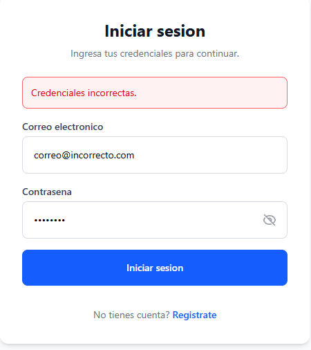|

---

### CP-07 — Logout (cerrar sesión) · HU-03

| Campo | Contenido |
|---|---|
| **Módulo** | Registro / Login |
| **Descripción** | El usuario cierra sesión y ya no puede acceder a rutas protegidas. |
| **Precondiciones** | El usuario `carlos@gmail.com` tiene sesión activa. |
| **Pasos** | 1. Desde el dashboard, hacer clic en **Cerrar sesión**.  2. Intentar navegar manualmente a `/dashboard` o a cualquier ruta protegida. |
| **Resultado esperado** | Se regresa a la vista pública (landing/login). Al intentar acceder a rutas protegidas, se redirige al login. El token es eliminado del almacenamiento del navegador. |
| **Estado** | ✅ Aprobado |
| **Evidencia** | 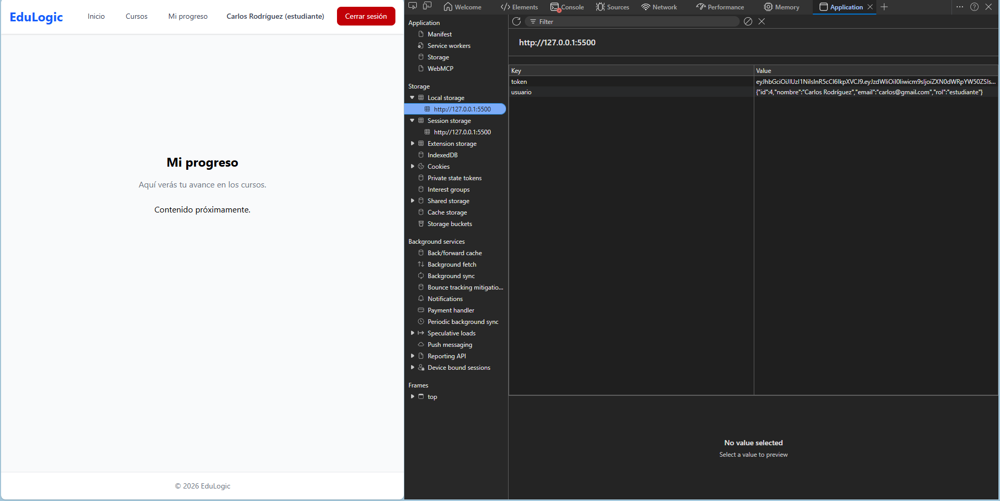 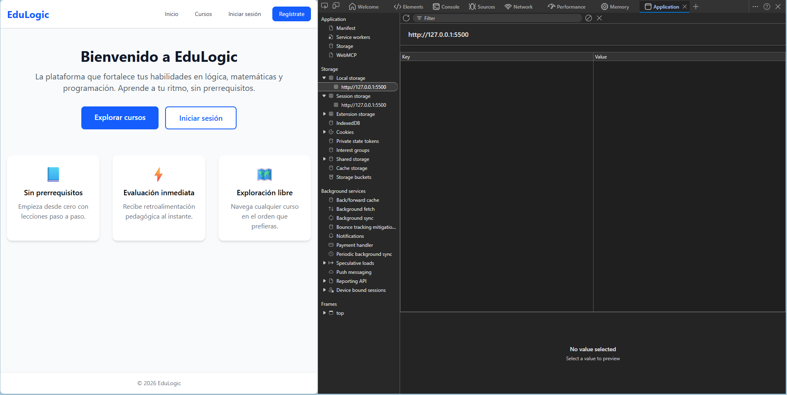 |

---

## 📚 Módulo 2 — Catálogo y cursos

> **Precondición global:** existe al menos un curso en la base de datos con título, descripción y nivel.

---

### CP-08 — Catálogo visible sin sesión (caso feliz) · HU-01

| Campo | Contenido |
|---|---|
| **Módulo** | Catálogo y cursos |
| **Descripción** | Un visitante sin cuenta puede ver el catálogo de cursos. |
| **Precondiciones** | Existen 2 o más cursos en la base de datos. El visitante NO está autenticado. |
| **Pasos** | 1. Abrir la URL principal de la aplicación sin iniciar sesión.  2. Navegar a la sección de catálogo. |
| **Resultado esperado** | Se listan los cursos con título, descripción y nivel. No se requiere login para ver esta vista. Si hay cursos, todos se muestran. |
| **Estado** | ✅ Aprobado |
| **Evidencia** | 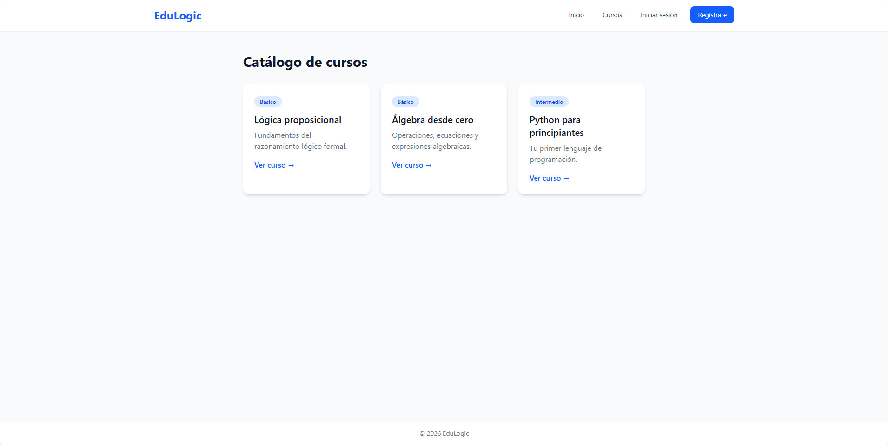 |

---

### CP-09 — Catálogo vacío muestra mensaje · HU-01

| Campo | Contenido |
|---|---|
| **Módulo** | Catálogo y cursos |
| **Descripción** | Si no hay cursos, se muestra un mensaje claro en lugar de pantalla vacía. |
| **Precondiciones** | La base de datos NO tiene ningún curso. |
| **Pasos** | 1. Abrir el catálogo sin iniciar sesión. |
| **Resultado esperado** | Se muestra un mensaje del tipo *"Aún no hay cursos disponibles"* o similar. La pantalla nunca queda vacía ni muestra errores técnicos. |
| **Estado** | ✅ Aprobado |
| **Evidencia** | Antes de crear los cursos reales |

---

### CP-10 — Curso inexistente devuelve 404 · HU-04

| Campo | Contenido |
|---|---|
| **Módulo** | Catálogo y cursos |
| **Descripción** | Acceder a un curso con ID que no existe muestra un error controlado. |
| **Precondiciones** | Usuario `estudiante1` (`carlos@gmail.com` / `contraseña_estudiante1`) con sesión activa. El curso con ID `99999` no existe. |
| **Pasos** | 1. Iniciar sesión como `carlos@gmail.com`.  2. Navegar manualmente a la URL del curso con ID inexistente (ej: `/cursos/99999`). |
| **Resultado esperado** | Se muestra una página de error amigable ("Curso no encontrado") o se redirige al catálogo. El servidor responde HTTP 404. No se rompe la aplicación. |
| **Estado** | ✅ Aprobado  |
| **Evidencia** | 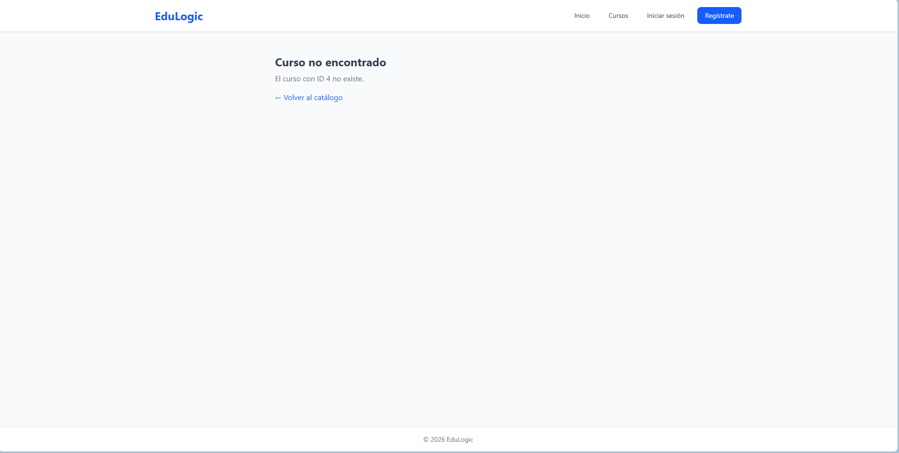 |

---

### CP-11 — Navegación desde curso a sus lecciones · HU-04

| Campo | Contenido |
|---|---|
| **Módulo** | Catálogo y cursos |
| **Descripción** | Desde el detalle de un curso se puede acceder a sus lecciones en orden. |
| **Precondiciones** | Existe un curso con 3 lecciones en orden 1, 2, 3. Usuario `carlos@gmail.com` con sesión activa. |
| **Pasos** | 1. Iniciar sesión como `carlos@gmail.com`.  2. Abrir el catálogo y entrar al curso.  3. Verificar el listado de lecciones.  4. Hacer clic en la lección 1. |
| **Resultado esperado** | Las lecciones aparecen en orden 1 → 2 → 3. Al hacer clic en una lección se abre su contenido. Las lecciones ya completadas se distinguen visualmente de las pendientes. |
| **Estado** | ✅ Aprobado |
| **Evidencia** | 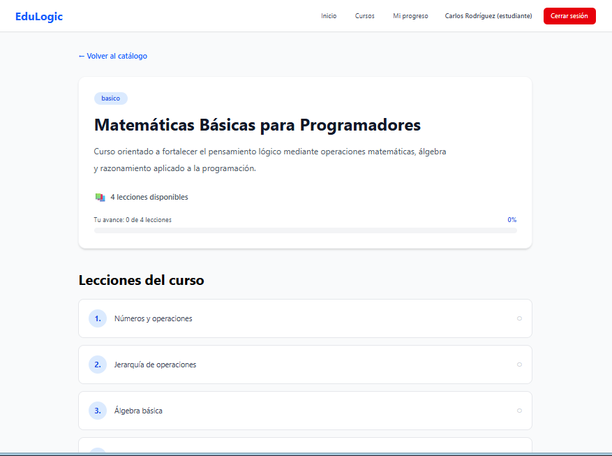 |

---

## 📖 Módulo 3 — Lecciones y progreso

> **Precondición global:** existe un curso con al menos 2 lecciones. El usuario `carlos@gmail.com` tiene sesión activa como estudiante.

---

### CP-12 — Leer el contenido de una lección (caso feliz) · HU-05

| Campo | Contenido |
|---|---|
| **Módulo** | Lecciones y progreso |
| **Descripción** | Un estudiante abre una lección y puede leer su contenido completo. |
| **Precondiciones** | Existe la lección "Lógica de programación desde cero" con contenido de texto. Estudiante `carlos@gmail.com` autenticado. |
| **Pasos** | 1. Entrar al curso desde el catálogo.  2. Hacer clic en la lección "Lógica de programación desde cero". |
| **Resultado esperado** | Se muestra el título y contenido completo de la lección. Hay botones para regresar al curso y para avanzar a la siguiente lección. Si la lección tiene cuestionario, hay un botón visible para presentarlo. |
| **Estado** | ✅ Aprobado |
| **Evidencia** | 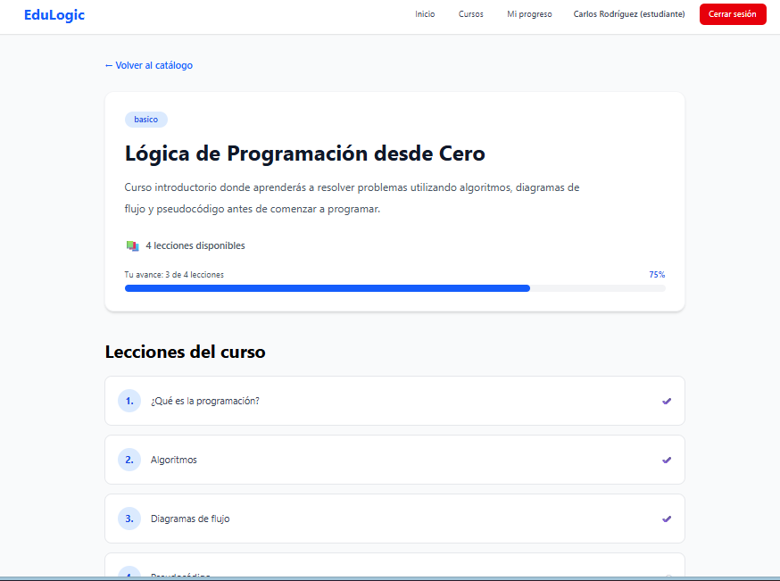 |

---

### CP-13 — Marcar lección como completada · HU-05

| Campo | Contenido |
|---|---|
| **Módulo** | Lecciones y progreso |
| **Descripción** | El estudiante marca una lección como completada y el progreso se actualiza de inmediato. |
| **Precondiciones** | Estudiante `carlos@gmail.com` autenticado. La lección NO ha sido marcada como completada antes por este usuario. El curso tiene 4 lecciones en total. |
| **Pasos** | 1. Abrir una lección del curso.  2. Hacer clic en el botón **Marcar como completada**.  3. Volver a la vista del curso. |
| **Resultado esperado** | La lección aparece visualmente como completada (ej: tilde verde o estilo diferente). El porcentaje de avance del curso sube (ej: de 0% a 25% si hay 4 lecciones). El cambio persiste si se recarga la página. |
| **Estado** | ✅ Aprobado |
| **Evidencia** | 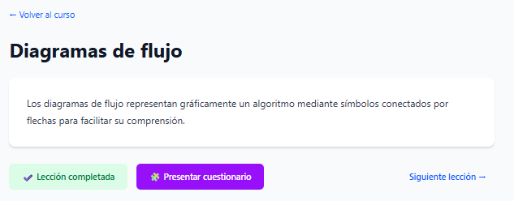 |

---

### CP-14 — No se duplica el progreso al marcar dos veces · HU-05, HU-08

| Campo | Contenido |
|---|---|
| **Módulo** | Lecciones y progreso |
| **Descripción** | Marcar la misma lección dos veces no genera registros duplicados ni altera el porcentaje. |
| **Precondiciones** | La lección YA fue marcada como completada por el estudiante en CP-13. Curso con 4 lecciones. |
| **Pasos** | 1. Abrir la misma lección ya completada.  2. Volver a hacer clic en **Marcar como completada** (si el botón sigue visible) o enviar la petición manualmente desde las DevTools del navegador (POST/PATCH al mismo endpoint).  3. Revisar el porcentaje del curso. |
| **Resultado esperado** | El porcentaje NO supera el 25% (sigue siendo 1 de 4 lecciones). La base de datos tiene exactamente UN registro de progreso para ese par usuario-lección (restricción `uq_progreso_usuario_leccion`). |
| **Estado** | ✅ Aprobado |
| **Evidencia** | 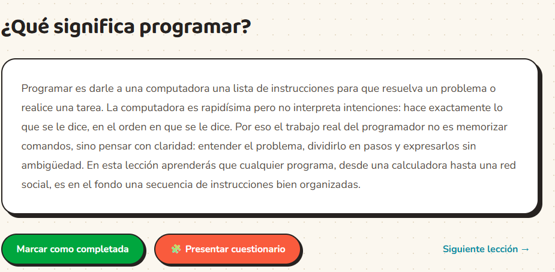 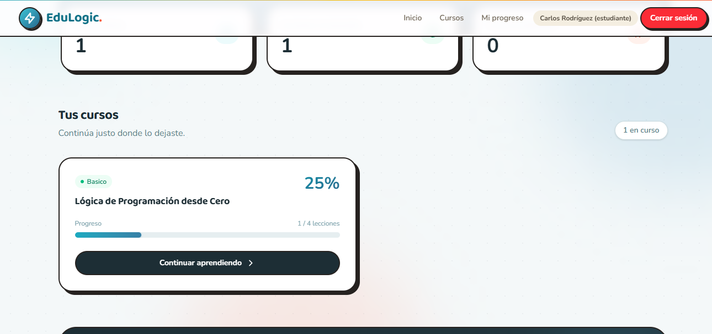 |

---

### CP-15 — Porcentaje de avance correcto · HU-08

| Campo | Contenido |
|---|---|
| **Módulo** | Lecciones y progreso |
| **Descripción** | El porcentaje de avance refleja exactamente las lecciones completadas. |
| **Precondiciones** | Curso con 4 lecciones. Estudiante `carlos@gmail.com` completó 2 de ellas. |
| **Pasos** | 1. Iniciar sesión como `carlos@gmail.com`.  2. Abrir el curso con 4 lecciones donde completó 2.  3. Observar el indicador de progreso. |
| **Resultado esperado** | El porcentaje muestra exactamente **50%** (2/4). Al completar una tercera lección, sube a **75%**. Los números coinciden con la actividad real. |
| **Estado** | ✅ Aprobado |
| **Evidencia** |    |

---

### CP-16 — Progreso independiente entre cursos · HU-09

| Campo | Contenido |
|---|---|
| **Módulo** | Lecciones y progreso |
| **Descripción** | El avance en un curso no afecta el progreso en otro curso diferente. |
| **Precondiciones** | Existen 2 cursos distintos (Curso A y Curso B), cada uno con 2 lecciones. Estudiante `luis@gmail.com` sin progreso previo. |
| **Pasos** | 1. Iniciar sesión como `luis@gmail.com`.  2. Completar la lección 1 del Curso A.  3. Ir al Curso B y revisar su progreso. |
| **Resultado esperado** | El Curso B muestra 0% de avance (no se alteró). El Curso A muestra 50%. Los datos de ambos cursos no se mezclan. |
| **Estado** | ✅ Aprobado |
| **Evidencia** | 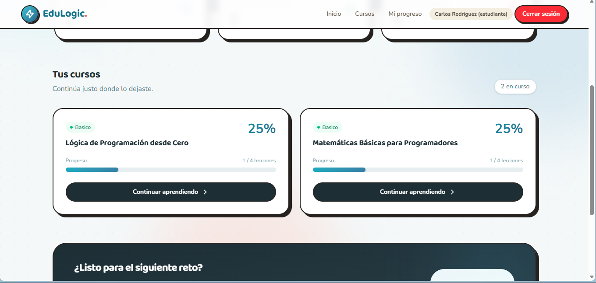 |

---

## 🧩 Módulo 4 — Quiz / Cuestionario *(módulo crítico)*

> **Precondición global de este módulo:**
> - Existe un cuestionario con **3 preguntas**, cada una con 4 opciones y UNA correcta.
> - Cada pregunta tiene su explicación pedagógica configurada.
> - El estudiante `ana@gmail.com` (contraseña: `contraseña_anita`) tiene sesión activa.
>
> *Este es el módulo central de EduLogic. Se exige especial atención en la cobertura.*

---

### CP-17 — Presentar quiz con todas las respuestas correctas (100 puntos) · HU-06, HU-07

| Campo | Contenido |
|---|---|
| **Módulo** | Quiz |
| **Descripción** | El estudiante responde correctamente todas las preguntas y obtiene 100 puntos. |
| **Precondiciones** | Cuestionario con 3 preguntas. Conocer qué opción es correcta en cada una. |
| **Pasos** | 1. Abrir la lección que contiene el cuestionario y hacer clic en **Presentar cuestionario**.  2. Seleccionar la opción correcta en las 3 preguntas.  3. Hacer clic en **Enviar**. |
| **Resultado esperado** | Se muestra el puntaje **100 / 100** de forma inmediata sin recargar la página. Cada pregunta aparece con marca de "correcta". No se muestran explicaciones de error (no hay errores). El intento queda registrado en la base de datos con `puntaje = 100.00`. |
| **Estado** | ✅ Aprobado |
| **Evidencia** | 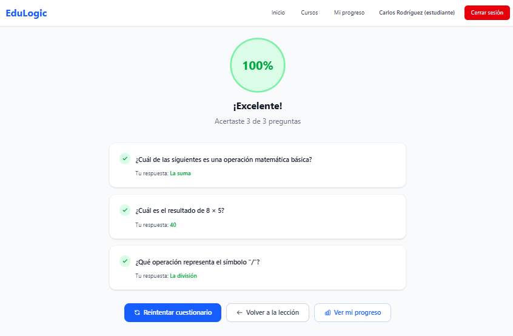 |

---

### CP-18 — Quiz con respuestas incorrectas: puntaje y explicaciones correctas · HU-07

| Campo | Contenido |
|---|---|
| **Módulo** | Quiz |
| **Descripción** | Al fallar preguntas, el puntaje es proporcional y aparecen las explicaciones pedagógicas. |
| **Precondiciones** | Cuestionario con 3 preguntas. Responder correctamente solo 1. |
| **Pasos** | 1. Abrir el cuestionario.  2. Responder 1 pregunta correctamente y 2 de forma incorrecta.  3. Enviar. |
| **Resultado esperado** | Puntaje mostrado: **33.33** (1 de 3). Las 2 preguntas falladas muestran: la opción elegida, cuál era la correcta y la explicación pedagógica configurada por el profesor. La pregunta correcta no muestra explicación de error. |
| **Estado** | ✅ Aprobado |
| **Evidencia** | 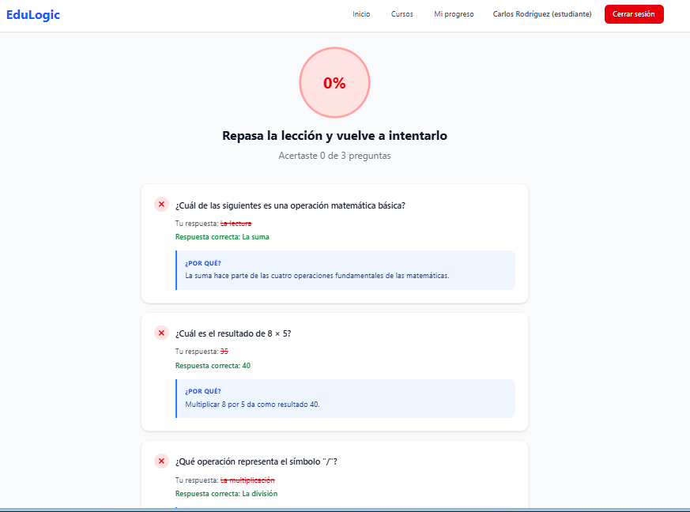 |

---

### CP-19 — Envío incompleto está bloqueado · HU-06

| Campo | Contenido |
|---|---|
| **Módulo** | Quiz |
| **Descripción** | No se puede enviar el cuestionario si hay preguntas sin responder. |
| **Precondiciones** | Cuestionario con 3 preguntas abierto. |
| **Pasos** | 1. Abrir el cuestionario.  2. Responder solo 2 de las 3 preguntas.  3. Intentar hacer clic en **Enviar**. |
| **Resultado esperado** | El botón de envío está deshabilitado o al hacer clic se muestra un mensaje indicando que hay preguntas sin responder. No se realiza ninguna petición al servidor. |
| **Estado** | ✅ Aprobado |
| **Evidencia** | 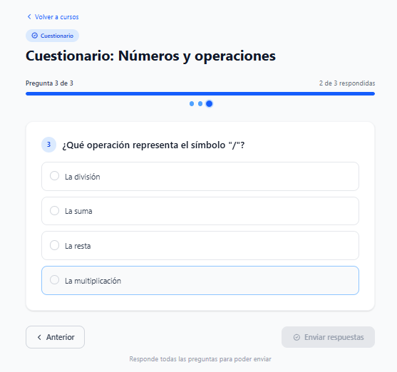 |

---

### CP-20 — Reintento del cuestionario · HU-07

| Campo | Contenido |
|---|---|
| **Módulo** | Quiz |
| **Descripción** | El estudiante puede presentar el mismo cuestionario más de una vez y cada intento queda registrado por separado. |
| **Precondiciones** | El estudiante `ana@gmail.com` ya presentó el cuestionario al menos una vez (ej: en CP-17). |
| **Pasos** | 1. Desde la pantalla de resultados, hacer clic en **Reintentar** (o volver a la lección y abrir el cuestionario de nuevo).  2. Responder todas las preguntas con respuestas distintas al primer intento.  3. Enviar. |
| **Resultado esperado** | Se muestra un nuevo resultado con el puntaje del segundo intento. En la base de datos existen ahora **2 registros** en la tabla `intentos` para `ana@gmail.com` y ese cuestionario, con fechas y puntajes propios e independientes. |
| **Estado** | ✅ Aprobado |
| **Evidencia** | 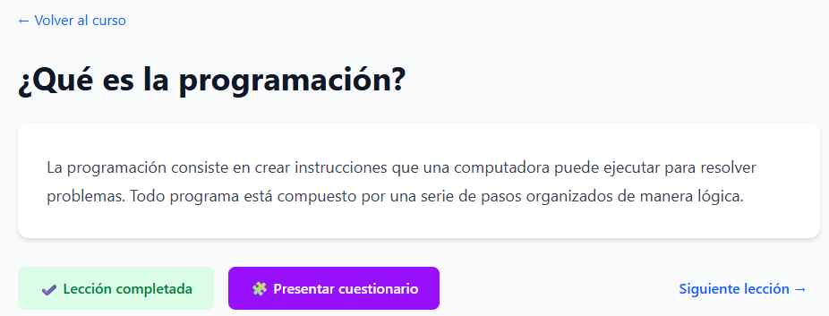 |

---

### CP-21 — Historial de intentos del estudiante · HU-10  
(Cerrado y anulado por decisión del equipo)

| Campo | Contenido |
|---|---|
| **Módulo** | Quiz |
| **Descripción** | El estudiante puede consultar todos sus intentos anteriores de un cuestionario con fecha y puntaje. |
| **Precondiciones** | El estudiante `ana@gmail.com` presentó el cuestionario 2 veces (ej: CP-17 y CP-20). |
| **Pasos** | 1. Navegar a la sección de historial del cuestionario (o revisar el perfil).  2. Observar la lista de intentos. |
| **Resultado esperado** | Se muestran los 2 intentos con su fecha y puntaje respectivo. Solo aparecen los intentos de ESTE estudiante, nunca los de otros usuarios. |
| **Estado** | ❌ Anulado |
| **Evidencia** | — |

---

### CP-22 — Profesor no puede presentar un quiz · HU-06

| Campo | Contenido |
|---|---|
| **Módulo** | Quiz |
| **Descripción** | Un usuario con rol profesor no puede enviar respuestas a un cuestionario. |
| **Precondiciones** | Usuario con rol `profesor` autenticado. Usar `profesor1` / `contraseña_profe1`. en un cuestionario existente. |
| **Pasos** | 1. Iniciar sesión como `profesor1`.  2. Navegar a una lección con cuestionario.  3. Intentar enviar respuestas al cuestionario (si hay botón, usarlo; si no, intentar directamente desde las DevTools o herramienta como Bruno/Postman con el token del profesor: `POST /cuestionarios/{id}/intentos`). |
| **Resultado esperado** | El sistema rechaza la acción. La interfaz no muestra el botón de "Presentar quiz" al profesor, o el servidor responde HTTP 403 si se intenta directamente vía API. |
| **Estado** | ✅ Aprobado |
| **Evidencia** | 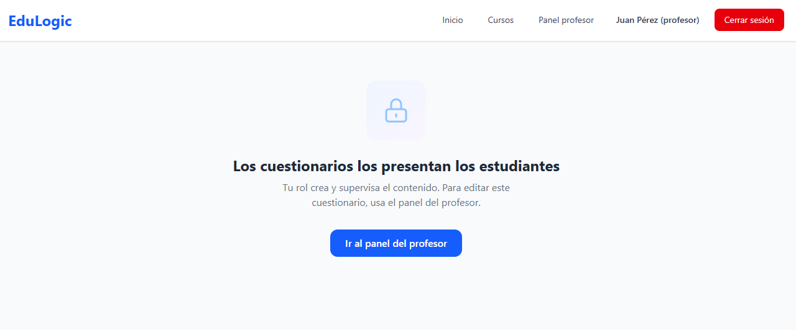 |

---

## 🔒 Módulo 5 — Permisos y rutas protegidas

> **Precondición global:** la aplicación tiene usuarios de los 3 roles activos en la base de datos.

---

### CP-23 — Ruta protegida redirige a login sin sesión · HU-03

| Campo | Contenido |
|---|---|
| **Módulo** | Permisos |
| **Descripción** | Acceder a cualquier ruta privada sin token redirige al login. |
| **Precondiciones** | El navegador no tiene ningún token guardado (limpiar localStorage si es necesario). |
| **Pasos** | 1. Abrir directamente la URL del dashboard o panel de cursos (ej: `/dashboard`, `/cursos/1/lecciones`). |
| **Resultado esperado** | Se redirige automáticamente a la página de login. No se muestra ningún contenido privado. El servidor responde HTTP 401 o 403 si la petición llega a la API sin token. |
| **Estado** | ✅ Aprobado |
| **Evidencia** |  |

---
### CP-24 — Profesor no puede editar cursos ajenos · HU-11

| Campo | Contenido |
|---|---|
| **Módulo** | Permisos |
| **Descripción** | Un profesor solo puede editar y eliminar SUS propios cursos, no los de otro profesor. |
| **Precondiciones** | Existen dos profesores: `profesor1` (contraseña `contraseña_profe1`) y `profesor2` (contraseña `contraseña_profe2`). El `profesor1` creó el Curso X. |
| **Pasos** | 1. Iniciar sesión como `profesor2`.  2. Intentar editar o eliminar el Curso X (del `profesor1`) directamente por URL o vía API con el token del `profesor2`. |
| **Resultado esperado** | La interfaz no muestra el Curso X en el panel del `profesor2`. La API responde HTTP 403 si se intenta la operación con el token del `profesor2`. |
| **Estado** | ✅ Aprobado |
| **Evidencia** | 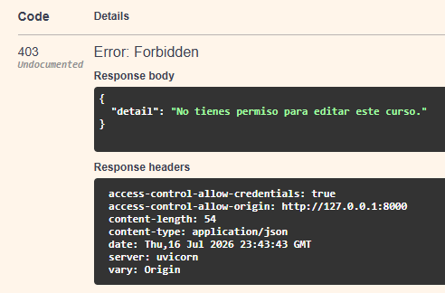 |

---

### CP-25 — Estudiante no accede al panel de administración · HU-15

| Campo | Contenido |
|---|---|
| **Módulo** | Permisos |
| **Descripción** | Un estudiante no puede acceder a la gestión de usuarios del admin. |
| **Precondiciones** | Usuario `luis@gmail.com` (rol `estudiante`) autenticado. |
| **Pasos** | 1. Iniciar sesión como `luis@gmail.com`.  2. Intentar navegar a `/admin` o equivalente.  3. Intentar vía API: `GET /admin/usuarios` con token de `luis@gmail.com`. |
| **Resultado esperado** | No hay enlace al panel admin en el menú del estudiante. La API responde HTTP 403. |
| **Estado** | ✅ Aprobado |
| **Evidencia** | 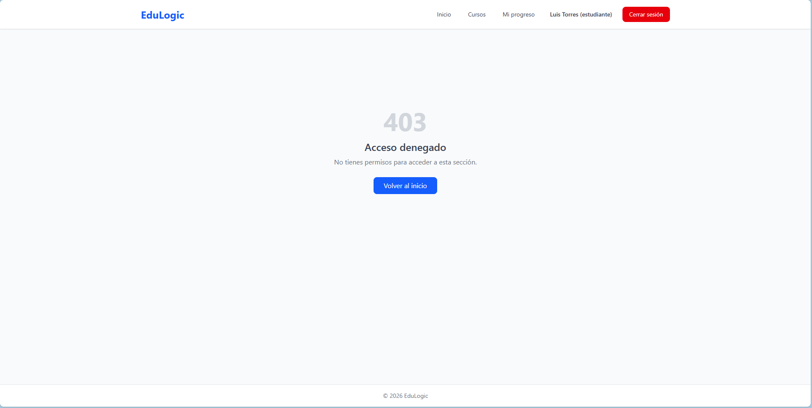 |

---

### CP-26 — Admin puede acceder a todo el contenido · HU-18

| Campo | Contenido |
|---|---|
| **Módulo** | Permisos |
| **Descripción** | El administrador tiene acceso a gestión de usuarios y todo el contenido. |
| **Precondiciones** | Usuario `admin` (contraseña `contraseña_admin`) autenticado. |
| **Pasos** | 1. Iniciar sesión como `admin`.  2. Abrir el panel de administración.  3. Verificar que puede ver la lista de usuarios.  4. Intentar editar un curso que pertenece a `profesor1`. |
| **Resultado esperado** | El admin visualiza el panel y la lista de usuarios. Puede editar o eliminar cualquier curso, lección o cuestionario. No recibe errores 403. |
| **Estado** | ✅ Aprobado |
| **Evidencia** | 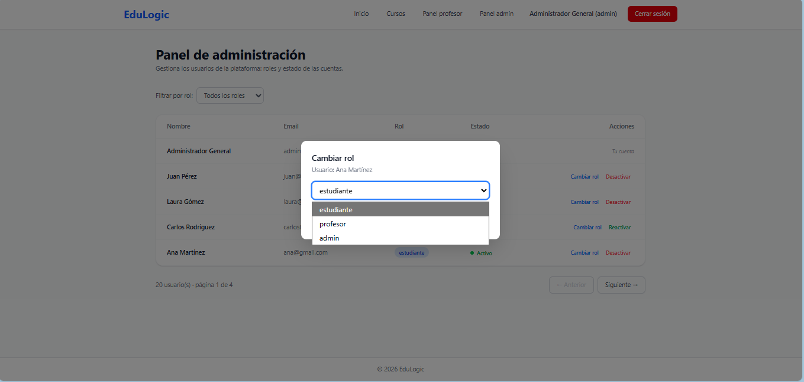 |

---

### CP-27 — Usuario inactivo no puede usar la API aunque tenga token válido · HU-17

| Campo | Contenido |
|---|---|
| **Módulo** | Permisos |
| **Descripción** | Si un admin desactiva al usuario mientras tiene sesión activa, el token ya no sirve. |
| **Precondiciones** | El usuario `luis@gmail.com` tiene sesión activa y un token válido. El `admin` va a desactivar esa cuenta. |
| **Pasos** | 1. Iniciar sesión como `luis@gmail.com` y obtener su token JWT.  2. Desde el panel de admin (sesión de `admin`), desactivar la cuenta de `luis@gmail.com`.  3. Usar el token original de `luis@gmail.com` para hacer `GET /auth/yo`. |
| **Resultado esperado** | El servidor responde HTTP 401 con mensaje *"Usuario no válido o cuenta desactivada"* aunque el token sea criptográficamente válido. |
| **Estado** | ✅ Aprobado |
| **Evidencia** |  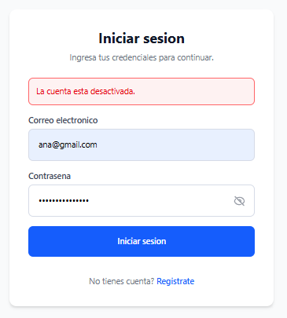 |

---

## 👨‍🏫 Módulo 6 — Panel del Profesor

> **Precondición global:** usuario `profesor1` autenticado (contraseña: `contraseña_profe1`).

---

### CP-28 — Crear curso completo (caso feliz) · HU-11

| Campo | Contenido |
|---|---|
| **Módulo** | Panel profesor |
| **Descripción** | El profesor crea un curso completo con título, descripción y nivel, y aparece en el catálogo. |
| **Precondiciones** | No existe un curso con título "Bases de Datos Relacionales" en la base de datos. |
| **Pasos** | 1. Iniciar sesión como `profesor1`.  2. Ir al panel del profesor → **Crear curso**.  3. Completar: título `Bases de Datos Relacionales`, descripción `Aprende SQL desde cero`, nivel `intermedio`.  4. Guardar.  5. Cerrar sesión e ir al catálogo como visitante. |
| **Resultado esperado** | El curso aparece en el panel del profesor. El catálogo público muestra el curso inmediatamente. El servidor responde HTTP 201. |
| **Estado** | ✅ Aprobado |
| **Evidencia** | 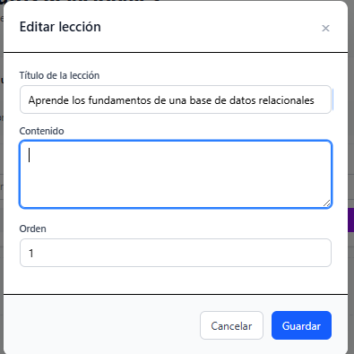 |

---

### CP-29 — Pregunta sin opción correcta es rechazada · HU-13

| Campo | Contenido |
|---|---|
| **Módulo** | Panel profesor |
| **Descripción** | No se puede guardar una pregunta si ninguna de sus opciones está marcada como correcta. |
| **Precondiciones** | `profesor1` autenticado. Existe un cuestionario en gestión dentro de una lección. |
| **Pasos** | 1. Iniciar sesión como `profesor1`.  2. Ir a la gestión del cuestionario de una lección.  3. Crear una nueva pregunta con enunciado y 4 opciones de respuesta.  4. **No marcar** ninguna opción como correcta.  5. Intentar guardar la pregunta. |
| **Resultado esperado** | El sistema bloquea el guardado y muestra un mensaje de error indicando que debe marcarse exactamente una opción correcta. El servidor rechaza la petición con HTTP 400. No se crea ningún registro en la base de datos. |
| **Estado** | ✅ Aprobado |
| **Evidencia** | 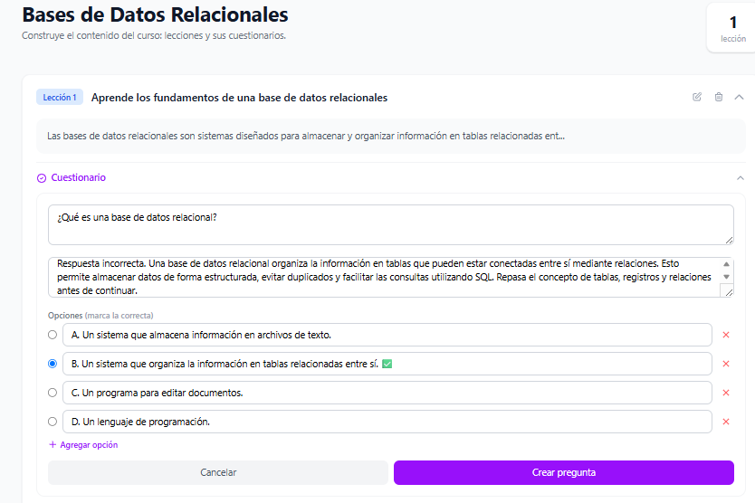 El sistema no permite "no marcar nada" |

---

## 🛡️ Módulo 7 — Panel del Administrador

> **Precondición global:** usuario con rol `admin` autenticado. Credenciales: `admin` / `contraseña_admin`

---

### CP-30 — Ver lista de usuarios con rol y estado · HU-15

| Campo | Contenido |
|---|---|
| **Módulo** | Panel admin |
| **Descripción** | El admin puede ver todos los usuarios registrados con su nombre, correo, rol y estado. |
| **Precondiciones** | Existen al menos 5 usuarios con diferentes roles en la base de datos (`admin`, `profesor1`, `profesor2`, `carlos@gmail.com`, `ana@gmail.com`, `luis@gmail.com`). |
| **Pasos** | 1. Iniciar sesión como admin.  2. Navegar al panel de gestión de usuarios. |
| **Resultado esperado** | Se listan todos los usuarios con: nombre, correo, rol (`estudiante`/`profesor`/`admin`) y estado (activo/inactivo). El campo contraseña nunca aparece. |
| **Estado** | ✅ Aprobado |
| **Evidencia** |  |

---

### CP-31 — Cambiar rol de usuario (promover estudiante a profesor) · HU-16

| Campo | Contenido |
|---|---|
| **Módulo** | Panel admin |
| **Descripción** | El admin puede cambiar el rol de un usuario y el cambio aplica de inmediato. |
| **Precondiciones** | Existe `luis@gmail.com` (estudiante3, contraseña `contraseña_Luis.`) con rol `estudiante`. |
| **Pasos** | 1. En el panel de usuarios, ubicar a `luis@gmail.com`.  2. Cambiar su rol a `profesor` y confirmar.  3. Cerrar sesión.  4. Iniciar sesión como `luis@gmail.com`. |
| **Resultado esperado** | El cambio pide confirmación antes de aplicar. Al iniciar sesión, `luis@gmail.com` tiene ahora acceso al panel del profesor y puede crear cursos. |
| **Estado** | ✅ Aprobado |
| **Evidencia** |  |

---

### CP-32 — Desactivar usuario · HU-17

| Campo | Contenido |
|---|---|
| **Módulo** | Panel admin |
| **Descripción** | El admin desactiva un usuario y ese usuario ya no puede iniciar sesión. |
| **Precondiciones** | Existe `carlos@gmail.com` (`estudiante1`) con cuenta activa y sin sesión iniciada. |
| **Pasos** | 1. En el panel de admin, localizar a `carlos@gmail.com`.  2. Hacer clic en **Desactivar** y confirmar.  3. Abrir otra pestaña o navegador e intentar iniciar sesión como `carlos@gmail.com` con contraseña `contraseña_estudiante1`. |
| **Resultado esperado** | El login de `carlos@gmail.com` devuelve el error *"La cuenta está desactivada."* (HTTP 401). Su historial de intentos y progreso sigue en la base de datos (no se borró). |
| **Estado** | ✅ Aprobado |
| **Evidencia** | 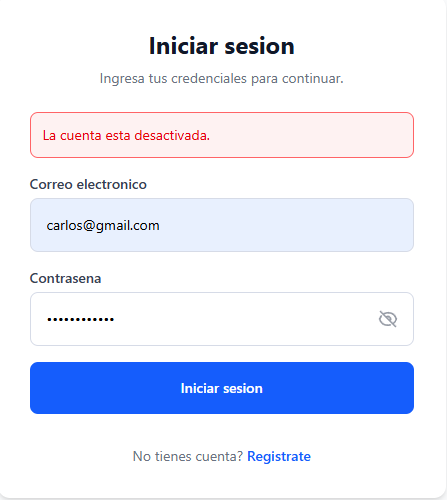 |

---

### CP-33 — Reactivar usuario (panel admin) · HU-17

| Campo | Contenido |
|---|---|
| **Módulo** | Panel admin |
| **Descripción** | Desde el panel de administración el admin reactiva un usuario previamente desactivado, permitiéndole volver a acceder a la plataforma con sus credenciales. |
| **Precondiciones** | Usuario `ana@gmail.com` (contraseña `contraseña_anita`) tiene la cuenta **desactivada**. Admin autenticado como `admin` / `contraseña_admin`. |
| **Pasos** | 1. Iniciar sesión como admin → ir al panel de gestión de usuarios.  2. Localizar a `ana@gmail.com` y hacer clic en **Reactivar** → confirmar.  3. Cerrar sesión como admin.  4. Intentar iniciar sesión como `ana@gmail.com` con la contraseña `contraseña_anita`.  5. Verificar el acceso a la plataforma y observar el código HTTP en las DevTools (pestaña Network). |
| **Resultado esperado** | El usuario `ana@gmail.com` inicia sesión correctamente y accede a la plataforma (HTTP 200). Se genera un token JWT válido. En el panel de administración, el estado del usuario aparece como **Activo**. El historial, progreso y demás información del usuario permanecen intactos. |
| **Estado** | ✅ Aprobado |
| **Evidencia** | 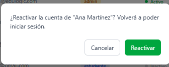|

---

## 📱 Módulo 8 — Responsive (diseño adaptativo)

> **Precondición global:** las pruebas se ejecutan en el navegador usando las DevTools (F12 → modo dispositivo).
> Resoluciones a verificar: **360 × 640 px** (móvil pequeño) y **1280 × 800 px** (escritorio).

---

### CP-34 — Catálogo y landing legibles en 360 px · HU-01

| Campo | Contenido |
|---|---|
| **Módulo** | Responsive |
| **Descripción** | La landing page y el catálogo de cursos son usables en pantalla de móvil pequeño (360 px). |
| **Precondiciones** | La aplicación está desplegada. DevTools abierto en modo dispositivo con ancho 360 px. |
| **Pasos** | 1. Abrir DevTools (F12) → pestaña **Toggle device toolbar** → configurar 360 × 640 px.  2. Navegar a la landing page.  3. Navegar al catálogo de cursos. |
| **Resultado esperado** | El texto es legible sin hacer zoom. Los botones son tocables (mínimo 44 × 44 px). No hay scroll horizontal. El menú de navegación es accesible (hamburguesa o equivalente). Las tarjetas de cursos se apilan en columna. |
| **Estado** | ✅ Aprobado |
| **Evidencia** | 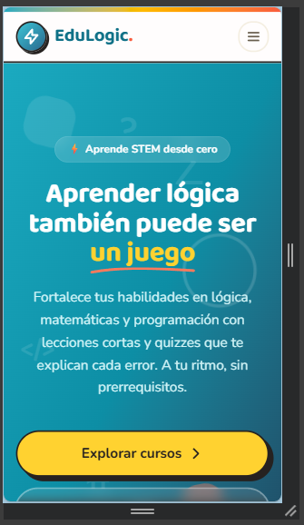 |

---

## 📊 Tabla maestra de trazabilidad

> Referencia rápida para verificar que cada historia de usuario tiene al menos un caso de prueba.

| Historia | Descripción corta | Casos que la cubren |
|---|---|---|
| HU-01 | Explorar catálogo sin sesión | CP-08, CP-09, CP-34 |
| HU-02 | Registrarse | CP-01, CP-02, CP-03, CP-04 |
| HU-03 | Login / Logout | CP-05, CP-06, CP-07, CP-23 |
| HU-04 | Ver detalle de curso | CP-10, CP-11 |
| HU-05 | Estudiar lección | CP-12, CP-13, CP-14 |
| HU-06 | Presentar cuestionario | CP-17, CP-18, CP-19, CP-22 |
| HU-07 | Corrección y explicación inmediata | CP-17, CP-18, CP-20 |
| HU-08 | Consultar progreso | CP-14, CP-15 |
| HU-09 | Navegar entre cursos | CP-16 |
| HU-10 | Historial de intentos | CP-21 | (Anulado por decisión del equipo)
| HU-11 | Gestionar cursos (profesor) | CP-24, CP-28 |
| HU-12 | Gestionar lecciones | CP-28 |
| HU-13 | Crear cuestionarios con retroalimentación | CP-29 |
| HU-14 | Panel del profesor | CP-24 |
| HU-15 | Gestionar usuarios (admin) | CP-30 |
| HU-16 | Cambiar rol de usuario | CP-31 |
| HU-17 | Desactivar usuario | CP-27, CP-32, CP-33 |
| HU-18 | Admin supervisa contenido | CP-26 |

---

## 🗒️ Notas para el equipo

1. **Orden sugerido de ejecución:** módulo 1 → 2 → 3 → 5 → 6 → 7 → 4 → 8.
   El quiz (módulo 4) requiere cursos, lecciones y cuestionarios creados previamente.

2. **Herramientas recomendadas:**
   - **Bruno** (o Postman) para probar endpoints directamente con token JWT.
   - **DevTools de Chrome/Firefox** para inspeccionar tráfico de red y responsive (CP-34).
   - **Supabase Table Editor** para verificar el estado de la base de datos después de operaciones.

3. **Evidencias:** al ejecutar un caso, tomar captura de pantalla y referenciarla en la columna **Evidencia** con la ruta relativa (ej: `./evidencias/CP-01-registro-exitoso.png`). Guardar las imágenes en `docs/pruebas/evidencias/`.

4. **Si un caso falla:** actualizar el estado a `❌ Falló`, describir el comportamiento observado en la columna Evidencia, y abrir una issue en GitHub etiquetada como `bug` referenciando el ID del caso (ej: `[Bug] CP-18: puntaje incorrecto`).

5. **Datos de prueba:** Todos los datos utilizados corresponden a datos de prueba. Las credenciales reales son administradas por el equipo de desarrollo y se comparten únicamente por canales privados.